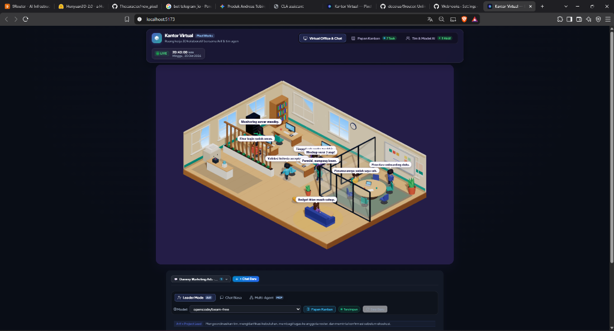
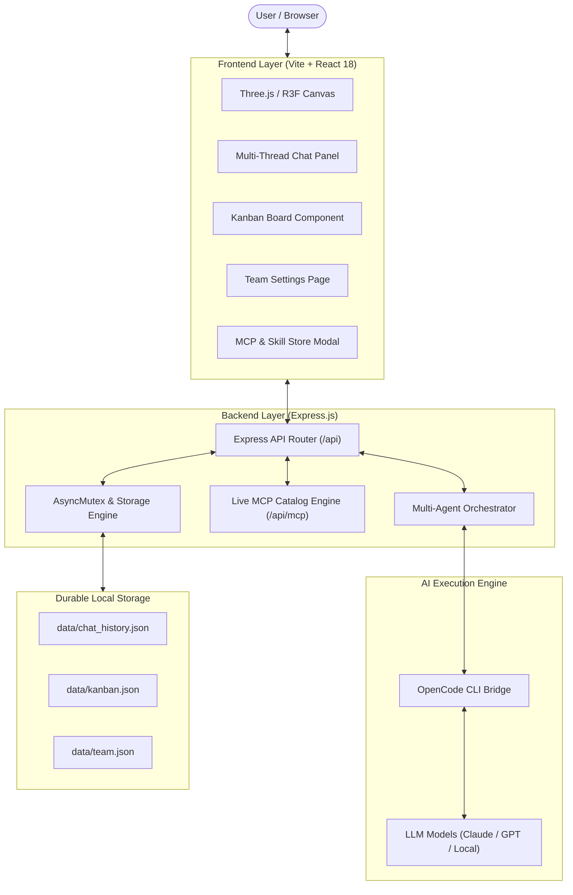

# Kantor Virtual — Pixel Works

<p align="center">
  <strong>Pilihan Bahasa / Language:</strong>
  <a href="README.md"><strong>English 🇬🇧</strong></a> | 
  <a href="README.id.md"><strong>Bahasa Indonesia 🇮🇩</strong></a>
</p>

<p align="center">
  <strong>Platform Kantor Virtual 3D Mandiri & Kolaborasi Tim AI Multi-Agent</strong>
  <br />
  Ruang kantor virtual 3D isometrik dengan orkestrasi tim AI mandiri, integrasi Model Context Protocol (MCP), papan Kanban proyek, dan chat multi-thread persisten.
</p>

<p align="center">
  <a href="https://react.dev"></a>
  <a href="https://threejs.org"></a>
  <a href="https://docs.pmnd.rs/react-three-fiber"></a>
  <a href="https://nodejs.org"></a>
  <a href="https://vitejs.dev"></a>
  <a href="https://expressjs.com"></a>
  
  <a href="LICENSE"></a>
  <a href="CLA.md"></a>
  <a href="CONTRIBUTING.id.md"></a>
</p>

<p align="center">
  
</p>

---

## Daftar Isi (Table of Contents)

- [Quick Start](#quick-start)
- [Fitur Utama](#fitur-utama)
- [Arsitektur Sistem](#arsitektur-sistem)
- [Roster Tim AI & Spesialisasi Agent](#roster-tim-ai--spesialisasi-agent)
- [Model Context Protocol (MCP) Tools](#model-context-protocol-mcp-tools)
- [Alur Kerja Sprint & Pipeline Kanban](#alur-kerja-sprint--pipeline-kanban)
- [Area Kontribusi yang Diharapkan (Wishlist)](#area-kontribusi-yang-diharapkan-wishlist)
- [Konfigurasi & Environment Variables](#konfigurasi--environment-variables)
- [Dokumentasi REST API](#dokumentasi-rest-api)
- [Pengujian & Verifikasi](#pengujian--verifikasi)
- [Struktur Direktori Proyek](#struktur-direktori-proyek)
- [Penyelesaian Masalah (Troubleshooting)](#penyelesaian-masalah-troubleshooting)
- [Panduan Kontribusi](#panduan-kontribusi)
- [Lisensi](#lisensi)

---

## Quick Start

Aplikasi dapat dijalankan secara lokal dalam beberapa langkah:

### 1. Prasyarat Sistem
- **Node.js** v18.0.0 atau versi lebih baru ([Unduh Node.js LTS](https://nodejs.org/))
- **npm** v9+ (terpasang otomatis dengan Node.js)
- *(Opsional)* **OpenCode CLI** v1.18+ untuk koneksi langsung ke provider LLM:
  ```bash
  npm install -g opencode
  opencode providers # Konfigurasi kredensial penyedia AI
  ```

### 2. Instalasi
Clone repositori dan pasang seluruh dependensi:

```bash
git clone https://github.com/Thecaracter/new_pixel.git
cd new_pixel
npm install
```

Salin template konfigurasi bila ingin menyesuaikan konfigurasi default:
```bash
cp .env.example .env
```

### 3. Menjalankan Aplikasi
Jalankan server pengembangan (Express Backend API + Vite Frontend Dev Server):

```bash
npm run dev
```

Akses aplikasi pada URL berikut:
- **Web Interface**: [http://localhost:5173](http://localhost:5173)
- **Backend API**: [http://127.0.0.1:3001](http://127.0.0.1:3001)

> [!TIP]
> **Mode Frontend-Only**: Jika Anda hanya ingin mengembangkan tampilan 3D atau antarmuka tanpa backend, jalankan `npm run dev:frontend`.

---

## Fitur Utama

### 1. Ruang Kantor 3D Isometrik Prosedural (Three.js & R3F)
- Dirender secara native menggunakan **React Three Fiber** tanpa membutuhkan unduhan model GLTF/OBJ eksternal yang berat.
- Rutinitas karakter dinamis: mengetik di meja kerja, rotasi kepala, berjalan di koridor, dan animasi kucing kantor (*Mochi the Cat*).
- Kamera isometrik responsif dengan pergerakan parallax halus yang mengikuti pointer mouse dan input sentuh.
- Efek pencahayaan lembut, bayangan isometrik, balon percakapan interaktif, dan partikel atmosfer kantor.

### 2. Orkestrasi Multi-Agent AI Terdistribusi
- **7 Persona Agent Spesifik**: Masing-masing memiliki batasan domain wewenang, sistem prompt teruji, dan akses tool mandiri.
- **Leader Mode (Arif)**: Alur kerja 2 fase yang terstruktur:
  1. *Clarifying Phase*: Elicitation requirement jika instruksi user belum cukup spesifik.
  2. *Awaiting Confirmation*: Pembuatan proposal rencana sprint berisi daftar tugas terperinci untuk masing-masing agent.
- **Multi-Agent Orchestrator (`/api/orchestrate`)**: Mengoordinasikan delegasi tugas silang, konsultasi antar-agent, dan sintesis hasil kerja terpadu.
- **Model Switching On-the-Fly**: Pilihan dropdown model AI (Claude 3.5 Sonnet, Claude Opus, GPT-4, dll.) dengan reset sesi otomatis untuk mencegah polusi konteks.

### 3. Integrasi Model Context Protocol (MCP)
- Live registry search untuk mencari tool dan MCP server resmi langsung dari ekosistem NPM.
- Penyediaan fungsi eksekusi nyata untuk agent berbasis skema standar MCP:
  - **Finance (Rina)**: `calculate_budget`, `generate_invoice_draft`, `financial_report_summary`.
  - **Design (Dimas)**: `create_wireframe_spec`, `design_system_tokens`, `ux_review_checklist`.
  - **Engineering & Operations**: Alat analisis spesifikasi komponen dan estimasi timeline.

### 4. Papan Kanban Proyek & Persetujuan Berjenjang
- **Approval Gating**: Rencana sprint dari Leader tidak pernah dieksekusi sebelum ada konfirmasi user (melalui input "setuju" di chat atau tombol persetujuan).
- **Idempotent Task Creation**: Percobaan persetujuan ulang tidak akan menduplikasi tugas yang sudah dibuat di Kanban.
- **Manajemen Multi-Project**: Filter dan pisahkan backlog tugas berdasarkan proyek tertentu.
- **Interaksi Status**: Pindahkan tugas antar kolom (*Backlog* ➔ *In Progress* ➔ *Done*) dengan pembaruan status real-time.

### 5. Chat Multi-Thread & Penyimpanan Durabel
- **Isolasi Thread Percakapan**: Kemampuan membuat topik obrolan baru, mengganti thread aktif, dan mengarsipkan diskusi lama.
- **Penyimpanan Durabel JSON**: Riwayat chat dan data kanban tersimpan permanen di `data/chat_history.json` dan `data/kanban.json`.
- **Atomic Writes & Concurrency Mutex**: Seluruh mutasi disk diserialisasi menggunakan `AsyncMutex` untuk mencegah *data corruption* atau *race condition*.

---

## 🎯 Area Kontribusi yang Diharapkan (Wishlist)

Kami sangat mengundang Anda untuk berkontribusi pada pengembangan fitur-fitur berikut:

1. **🎨 3D Three.js & Objek Kantor Baru**:
   - Perabotan interaktif baru: mesin kopi espresso dengan partikel uap, meja biliar/ping-pong di area santai, rak server berlampu LED, dan tanaman hias.
   - Siklus pencahayaan siang/malam (*Day/Night cycle*), shader cuaca (rintik hujan di jendela), dan kontrol zoom kamera isometrik halus.
   - Aksesori avatar baru (kacamata, headphone) dan animasi idle karakter (menyeruput kopi, peregangan).
2. **🛠️ Integrasi Tool MCP Baru**:
   - Integrasi MCP populer: PostgreSQL, GitHub, Slack, Discord, Notion, Jira, dan Linear.
   - Ekstensi tool runner mandiri di `server/mcp/`.
3. **🤖 Kecerdasan Agent & Provider LLM**:
   - Dukungan koneksi LLM lokal via Ollama, LM Studio, atau vLLM.
   - Peningkatan alur *Peer Review* antar agen (misal QA menguji kode Developer secara otomatis sebelum task selesai).
4. **📊 Kanban, Audio & Pengalaman Pengguna (UI/UX)**:
   - Drag-and-drop tugas di Kanban, penanggalan batas waktu (*due dates*), dan ekspor data ke Markdown/JSON.
   - Efek suara retro 8-bit (suara ketikan keyboard, lonceng task selesai) dengan tombol mute.
5. **⚡ Performa & Optimasi WebGL**:
   - Optimasi FPS di perangkat laptop hemat daya (*geometry batching* & *instancing*).

Detail teknis panduan kontribusi dapat dibaca pada berkas [CONTRIBUTING.id.md](CONTRIBUTING.id.md).

---

## Arsitektur Sistem



---

## Roster Tim AI & Spesialisasi Agent

| Nama | Peran | Spesialisasi | Tool MCP yang Digunakan | Warna Avatar |
| :--- | :--- | :--- | :--- | :--- |
| **Arif** | Team Leader & Orchestrator | Perencanaan sprint, delegasi tugas, validasi requirement | Orchestrator Engine | `#4F46E5` (Indigo) |
| **Budi** | Frontend Engineer | React 18, Three.js, CSS, animasi interaktif | Web Component Spec | `#059669` (Hijau Zamrud) |
| **Siti** | Backend Engineer | API Express, skema database, integritas storage | Data Contract Tools | `#D97706` (Amber Emas) |
| **Dimas** | UI/UX Designer | Wireframe, token desain, audit aksesibilitas | `create_wireframe_spec` | `#7C3AED` (Ungu) |
| **Rina** | Finance Specialist | Perhitungan budget sprint, estimasi biaya cloud | `calculate_budget` | `#DC2626` (Merah Mawar) |
| **Bayu** | DevOps Specialist | CI/CD pipeline, monitoring, optimasi build | Deployment Tools | `#0284C7` (Sky Blue) |
| **Maya** | QA Specialist | Unit test, skenario validasi, verifikasi kontrak | Testing Suite Runner | `#EA580C` (Oranye) |

---

## Pengujian & Verifikasi

Proyek ini dilengkapi test suite otomatis (Node.js Test Runner native) yang memverifikasi kepatuhan kontrak API, isolasi multi-thread, serta pencarian katalog live MCP:

```bash
# Jalankan seluruh test suite (29 tests)
npm test

# Jalankan verifikasi build produksi
npm run build
```

---

## Panduan Kontribusi

Kami sangat menyambut kontribusi dari komunitas global!
- **Persetujuan CLA**: Semua kontributor menyetujui [CLA.md](CLA.md) dengan mencentang kotak persetujuan pada template Pull Request saat mengajukan PR.
- **Panduan Selengkapnya**: Silakan baca [CONTRIBUTING.id.md](CONTRIBUTING.id.md) untuk konvensi branch, arsitektur `data/team.json`, dan verifikasi pengujian.

---

## Lisensi & Dual Licensing (License)

Pixel Works Virtual Office dirilis di bawah model **Dual Licensing**:

1. **Lisensi Komunitas Open Source (GNU AGPLv3)**:
   - Gratis untuk penggunaan pribadi, non-komersial, dan open-source.
   - Pihak yang menjalankan atau memodifikasi software ini melalui jaringan/web (SaaS) **wajib membuka seluruh kode sumber mereka** di bawah lisensi AGPLv3 yang sama.
2. **Lisensi Komersial (Proprietary / Enterprise)**:
   - Diwajibkan bagi perusahaan atau entitas yang ingin menggunakan software ini di lingkungan tertutup (*closed-source SaaS*, aplikasi internal perusahaan berbayar, atau penjualan lisensi komersial).
   - Hubungi Pemilik Proyek untuk pembelian Lisensi Komersial resmi.

Dokumen lisensi lengkap:
- [LICENSE](LICENSE) (Dual Licensing Notice & GNU AGPLv3)
- [CLA.md](CLA.md) (Contributor License Agreement)

Hak Cipta (c) 2026 Pixel Works Virtual Office. Hak Cipta Dilindungi Undang-Undang.
