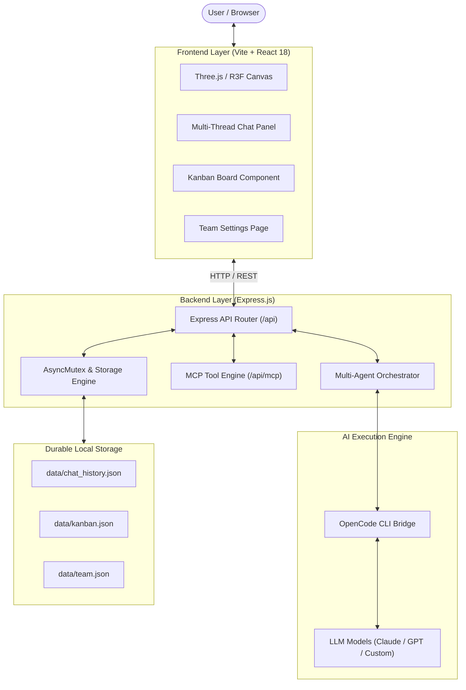

# Kantor Virtual — Pixel Works

<p align="center">
  <strong>Autonomous 3D Virtual Office & Multi-Agent Collaboration Platform</strong>
  <br />
  Ruang kantor virtual 3D isometrik dengan orkestrasi tim AI mandiri, integrasi Model Context Protocol (MCP), papan Kanban proyek, dan chat multi-thread persisten.
</p>

<p align="center">
  <a href="https://react.dev"></a>
  <a href="https://threejs.org"></a>
  <a href="https://docs.pmnd.rs/react-three-fiber"></a>
  <a href="https://nodejs.org"></a>
  <a href="https://vitejs.dev"></a>
  <a href="https://expressjs.com"></a>
  
  <a href="LICENSE"></a>
  <a href="CONTRIBUTING.md"></a>
</p>

---

## Daftar Isi (Table of Contents)

- [Quick Start](#quick-start)
- [Fitur Utama](#fitur-utama)
- [Arsitektur Sistem](#arsitektur-sistem)
- [Roster Tim AI & Spesialisasi Agent](#roster-tim-ai--spesialisasi-agent)
- [Model Context Protocol (MCP) Tools](#model-context-protocol-mcp-tools)
- [Alur Kerja Sprint & Pipeline Kanban](#alur-kerja-sprint--pipeline-kanban)
- [Konfigurasi & Environment Variables](#konfigurasi--environment-variables)
- [Dokumentasi REST API](#dokumentasi-rest-api)
- [Pengujian & Verifikasi](#pengujian--verifikasi)
- [Struktur Direktori Proyek](#struktur-direktori-proyek)
- [Penyelesaian Masalah (Troubleshooting)](#penyelesaian-masalah-troubleshooting)
- [Panduan Kontribusi](#panduan-kontribusi)
- [Lisensi](#lisensi)

---

## Quick Start

Aplikasi dapat dijalankan secara lokal dalam beberapa langkah:

### 1. Prasyarat Sistem
- **Node.js** v18.0.0 atau versi lebih baru ([Unduh Node.js LTS](https://nodejs.org/))
- **npm** v9+ (terpasang otomatis dengan Node.js)
- *(Opsional)* **OpenCode CLI** v1.18+ untuk koneksi langsung ke provider LLM:
  ```bash
  npm install -g opencode
  opencode providers # Konfigurasi kredensial penyedia AI
  ```

### 2. Instalasi

Clone repositori dan pasang seluruh dependensi:

```bash
git clone https://github.com/<username>/new_pixel.git
cd new_pixel
npm install
```

Salin template konfigurasi bila ingin menyesuaikan konfigurasi default:
```bash
cp .env.example .env
```

### 3. Menjalankan Aplikasi

Jalankan server pengembangan (Express Backend API + Vite Frontend Dev Server):

```bash
npm run dev
```

Akses aplikasi pada URL berikut:
- **Web Interface**: [http://localhost:5173](http://localhost:5173)
- **Backend API**: [http://127.0.0.1:3001](http://127.0.0.1:3001)

> [!TIP]
> **Mode Frontend-Only**: Jika Anda hanya ingin mengembangkan tampilan 3D atau antarmuka tanpa backend, jalankan `npm run dev:frontend`.

---

## Fitur Utama

### 1. Ruang Kantor 3D Isometrik Prosedural (Three.js & R3F)
- Dirender secara native menggunakan **React Three Fiber** tanpa membutuhkan unduhan model GLTF/OBJ eksternal yang berat.
- Rutinitas karakter dinamis: mengetik di meja kerja, rotasi kepala, berjalan di koridor, dan animasi kucing kantor (*Mochi the Cat*).
- Kamera isometrik responsif dengan pergerakan parallax halus yang mengikuti pointer mouse dan input sentuh.
- Efek pencahayaan lembut, bayangan isometrik, balon percakapan interaktif, dan partikel atmosfer kantor.

### 2. Orkestrasi Multi-Agent AI Terdistribusi
- **7 Persona Agent Spesifik**: Masing-masing memiliki batasan domain wewenang, sistem prompt teruji, dan akses tool mandiri.
- **Leader Mode (Arif)**: Alur kerja 2 fase yang terstruktur:
  1. *Clarifying Phase*: Elicitation requirement jika instruksi user belum cukup spesifik.
  2. *Awaiting Confirmation*: Pembuatan proposal rencana sprint berisi daftar tugas terperinci untuk masing-masing agent.
- **Multi-Agent Orchestrator (`/api/orchestrate`)**: Mengoordinasikan delegasi tugas silang, konsultasi antar-agent, dan sintesis hasil kerja terpadu.
- **Model Switching On-the-Fly**: Pilihan dropdown model AI (Claude 3.5 Sonnet, Claude Opus, Claude Haiku, GPT-4, dll.) dengan reset sesi otomatis untuk mencegah polusi konteks.

### 3. Integrasi Model Context Protocol (MCP)
- Penyediaan fungsi eksekusi nyata untuk agent berbasis skema standar MCP:
  - **Finance (Rina)**: `calculate_budget`, `generate_invoice_draft`, `financial_report_summary`.
  - **Design (Dimas)**: `create_wireframe_spec`, `design_system_tokens`, `ux_review_checklist`.
  - **Engineering & Operations**: Alat analisis spesifikasi komponen dan estimasi timeline.

### 4. Papan Kanban Proyek & Persetujuan Berjenjang
- **Approval Gating**: Rencana sprint dari Leader tidak pernah dieksekusi sebelum ada konfirmasi user (melalui input "setuju" di chat atau tombol persetujuan).
- **Idempotent Task Creation**: Percobaan persetujuan ulang tidak akan menduplikasi tugas yang sudah dibuat di Kanban.
- **Manajemen Multi-Project**: Filter dan pisahkan backlog tugas berdasarkan proyek tertentu.
- **Interaksi Status**: Pindahkan tugas antar kolom (*Backlog* ➔ *In Progress* ➔ *Done*) dengan pembaruan status real-time.

### 5. Chat Multi-Thread & Penyimpanan Durabel
- **Isolasi Thread Percakapan**: Kemampuan membuat topik obrolan baru, mengganti thread aktif, dan mengarsipkan diskusi lama.
- **Penyimpanan Durabel JSON**: Riwayat chat dan data kanban tersimpan permanen di `data/chat_history.json` dan `data/kanban.json`.
- **Atomic Writes & Concurrency Mutex**: Seluruh mutasi disk diserialisasi menggunakan `AsyncMutex` untuk mencegah *data corruption* atau *race condition*.
- **Proteksi Batasan Data (DoS Guard)**: Penerapan batas maksimum karakter pada judul, deskripsi tugas, dan batas kuota pesan.

### 6. Kustomisasi Profil Tim (Team Settings)
- Konfigurasi profil anggota tim secara dinamis melalui halaman pengaturan:
  - Aktifkan/nonaktifkan anggota tertentu dari ruang kantor 3D.
  - Personalisasi warna pakaian (baju, celana, rambut, kulit).
  - Tentukan model LLM independen untuk masing-masing agent.

---

## Arsitektur Sistem



---

## Roster Tim AI & Spesialisasi Agent

| Agent | Peran / Jabatan | Domain MCP | Tanggung Jawab Teknis |
| :--- | :--- | :--- | :--- |
| **Arif** | `Project Lead / Coordinator` | Operations, Management | Elicitation requirement, breakdown tugas sprint, delegasi antar-agent |
| **Rina** | `Finance / Accountant` | Finance | Kalkulasi estimasi budget, draft invoice, analisis laporan keuangan |
| **Dimas** | `UI/UX Designer` | Design | Desain sistem antarmuka, pembuatan spesifikasi wireframe, review UX |
| **Bayu** | `Product / Frontend Engineer` | Engineering | Implementasi komponen antarmuka, integrasi logika, optimasi performa |
| **Sinta** | `Marketing / Growth` | Marketing | Strategi go-to-market, copywriting promosi, perancangan kampanye |
| **Mira** | `Sales / Client Relations` | Sales | Riset kebutuhan prospek, penyusunan pitching proposal, komunikasi klien |
| **Eko** | `Operations / Admin Support` | Operations | Manajemen timeline sprint, verifikasi kelengkapan dokumen, administrasi |

---

## Model Context Protocol (MCP) Tools

Agen AI dapat memanggil tools terstandarisasi untuk mendapatkan hasil kalkulasi dan dokumen terstruktur:

- `calculate_budget`: Menghitung estimasi biaya berdasarkan item, kuantitas, dan mata uang (default: `IDR`).
- `generate_invoice_draft`: Menyusun dokumen draf invoice (`INV-XXXXXX`) dengan tanggal jatuh tempo.
- `financial_report_summary`: Mengolah perbandingan pemasukan vs pengeluaran menjadi persentase margin keuntungan.
- `create_wireframe_spec`: Menyusun spesifikasi teknis antarmuka halaman web, hierarki komponen, dan user flow.
- `design_system_tokens`: Menghasilkan token desain warna, tipografi, dan spasi untuk implementasi antarmuka.

> [!NOTE]
> Daftar endpoint dan skema parameter tools dapat diinspeksi secara dinamis via `GET /api/mcp/tools`.

---

## Alur Kerja Sprint & Pipeline Kanban

```text
[Input Kebutuhan dari User]
          │
          ▼
   [Leader: Arif]
          │
          ├──────────────┐
          ▼              ▼
[Kebutuhan Ambigu?]   [Kebutuhan Lengkap]
          │              │
          ▼              ▼
  [Fase Clarifying]  [Fase Awaiting Confirmation]
  (Minta rincian)    (Breakdown Sprint & Daftar Task)
                         │
                         ├─────────────────────────────┐
                         ▼                             ▼
                 [Balas: "setuju"]             [Klik: Approve Plan]
                         │                             │
                         └──────────────┬──────────────┘
                                        ▼
                         [Idempotency & Mutex Check]
                                        ▼
                         [Task Ditambahkan ke Backlog]
                                        ▼
                      [Pergerakan Kanban: In Progress ➔ Done]
```

---

## Konfigurasi & Environment Variables

Pengaturan sistem dapat disesuaikan menggunakan berkas `.env` di root direktori proyek:

| Variabel | Tipe | Nilai Default | Deskripsi |
| :--- | :---: | :---: | :--- |
| `BACKEND_PORT` | `Number` | `3001` | Port jaringan untuk layanan Express Backend |
| `OPENCODE_MODELS` | `String` | *(Daftar bawaan)* | Daftar identifier model AI yang dipisahkan koma |
| `CHAT_STORAGE_FILE` | `String` | `data/chat_history.json` | Lokasi berkas penyimpanan persisten riwayat chat |
| `KANBAN_STORAGE_FILE` | `String` | `data/kanban.json` | Lokasi berkas penyimpanan persisten data Kanban |
| `NODE_ENV` | `String` | `development` | Status environment runtime (`development` / `production`) |

Contoh isi `.env`:
```ini
BACKEND_PORT=3001
OPENCODE_MODELS=9router/claude-haiku-4.5-thinking-agentic,9router/claude-opus-4-1-latest,9router/claude-sonnet-4-20250514
NODE_ENV=development
```

---

## Dokumentasi REST API

### 1. Layanan Chat & AI

#### `POST /api/chat`
Mengirim prompt percakapan ke mode percakapan standar atau mode Leader koordinasi.

- **Request Body**:
  ```json
  {
    "message": "Kita ingin membuat modul integrasi payment gateway",
    "mode": "leader",
    "sessionId": "ses_opsional",
    "model": "9router/claude-opus-4-1-latest"
  }
  ```

- **Response Body (Leader - Clarifying Phase)**:
  ```json
  {
    "reply": "Sebelum membagi tugas, mohon konfirmasi beberapa poin teknis berikut.",
    "sessionId": "ses_ede0a6b9effe8TjiONpWANC1k4",
    "model": "9router/claude-opus-4-1-latest",
    "mode": "leader",
    "phase": "clarifying",
    "questions": [
      "Payment gateway apa yang akan digunakan (Midtrans, Xendit, Stripe)?",
      "Apakah memerlukan webhook handler untuk verifikasi status instan?"
    ],
    "plan": null
  }
  ```

#### `POST /api/orchestrate`
Memicu alur kerja koordinasi multi-agent untuk tugas lintas divisi.

#### `GET /api/chat/threads` & `POST /api/chat/threads`
Mendapatkan semua thread percakapan aktif atau membuat thread baru.

#### `POST /api/chat/approve-plan`
Menyetujui sprint plan dan secara aman memasukkan seluruh sub-task ke Kanban backlog.

---

### 2. Layanan Kanban & Proyek

- `GET /api/kanban/tasks`: Mengambil seluruh daftar tugas dan kolom Kanban.
- `POST /api/kanban/tasks`: Membuat tugas baru secara manual.
- `PATCH /api/kanban/tasks/:id`: Memperbarui posisi kolom atau atribut tugas.
- `DELETE /api/kanban/tasks/:id`: Menghapus tugas dari sistem.
- `GET /api/kanban/projects` & `POST /api/kanban/projects`: Mengelola kategori proyek Kanban.

---

### 3. Layanan Roster Tim & Sistem

- `GET /api/team`: Mengambil daftar profil dan konfigurasi visual anggota tim.
- `POST /api/team`: Mendaftarkan agent atau anggota tim baru.
- `PUT /api/team/:id`: Memperbarui atribut, warna pakaian, atau model AI agent.
- `GET /api/models`: Mengambil daftar model AI yang siap digunakan.
- `GET /api/mcp/tools`: Mengambil metadata tools MCP yang tersedia.
- `GET /api/health`: Endpoint pemeriksaan kesehatan layanan (*health check*).

---

## Pengujian & Verifikasi

Proyek menggunakan runner pengujian terintegrasi Node.js (`node:test`) tanpa dependensi pihak ketiga tambahan:

```bash
# Menjalankan seluruh rangkaian tes (Unit + Integration + Contracts)
npm test

# Menjalankan unit tests cepat (Leader Prompt, Team Store, Thread & Project Scoping)
npm run test:unit

# Menjalankan integration tests (Chat Contract & Kanban Persistence)
npm run test:integration
```

> [!NOTE]
> Seluruh pengujian unit berjalan dalam memori dan berkas sementara yang dibersihkan secara otomatis setelah pengujian selesai.

---

## Struktur Direktori Proyek

```text
new_pixel/
├── data/                         # Berkas penyimpanan data JSON durabel
│   ├── chat_history.json         # Riwayat thread, pesan, dan sesi
│   ├── kanban.json               # Tugas, status kolom, dan riwayat plan
│   └── team.json                 # Konfigurasi kustom anggota tim
├── public/                       # Aset web statis
├── server/                       # Layanan Backend Express.js
│   ├── agents/                   # Logika agen cerdas
│   │   ├── definitions.js        # Persona prompt, domain wewenang, dan tools
│   │   └── orchestrator.js       # Mesin orkestrasi kolaborasi multi-agent
│   ├── mcp/                      # Modul Model Context Protocol
│   │   ├── server.js             # Engine runtime pemanggilan tool
│   │   └── tools.js              # Definisi fungsi domain (Finance, Design, dll.)
│   ├── index.js                  # Entrypoint server dan rute endpoint REST
│   └── storage.js                # AsyncMutex & operasi penulisan file atomik
├── src/                          # Aplikasi Frontend React 18
│   ├── components/               # Komponen antarmuka pengguna
│   │   ├── three/                # Ruang 3D Three.js & React Three Fiber
│   │   │   ├── CatMochi.jsx      # Karakter kucing kantor interaktif
│   │   │   ├── Character.jsx     # Mesh karakter dan sistem animasi
│   │   │   ├── Characters.jsx    # Manajemen penempatan karakter di ruangan
│   │   │   ├── Furniture.jsx     # Meja, kursi kerja, komputer, rak
│   │   │   ├── OfficeCanvas.jsx  # Stage Three.js Canvas dan kontrol sudut pandang
│   │   │   └── OfficeRoom.jsx    # Lantai isometrik, dinding, dan pencahayaan
│   │   ├── ChatPanel.jsx         # Antarmuka panel percakapan dan thread
│   │   ├── KanbanBoard.jsx       # Papan alur kerja tugas Kanban
│   │   ├── OfficeHeader.jsx      # Header navigasi utama
│   │   ├── TeamSettingsPage.jsx  # Halaman kustomisasi roster dan karakter
│   │   └── VirtualOfficePage.jsx # Halaman kontainer utama
│   ├── App.jsx                   # Root component dengan Error Boundary
│   ├── index.css                 # Sistem desain global
│   └── main.jsx                  # Titik inisialisasi React DOM
├── tests/                        # Berkas pengujian otomatis (Node.js test runner)
│   ├── api-chat-contract.mjs
│   ├── durable-chat-kanban.mjs
│   ├── leader-contract.mjs
│   ├── team-management.mjs
│   └── thread-and-project-kanban.mjs
├── .env.example                  # Template variabel lingkungan
├── CONTRIBUTING.md               # Pedoman kontribusi untuk developer
├── LICENSE                       # Berkas lisensi terbuka MIT
├── package.json                  # Konfigurasi dependensi dan skrip proyek
└── vite.config.js                # Konfigurasi bundler Vite dan API reverse proxy
```

---

## Penyelesaian Masalah (Troubleshooting)

### 1. Pesan "Backend not running — start with: npm run dev"
Frontend Vite tidak dapat menghubungi API backend pada port `3001`.
- Pastikan menjalankan perintah `npm run dev` (bukan `npm run dev:frontend`).
- Jika port 3001 sedang digunakan oleh aplikasi lain, gunakan port berbeda:
  ```bash
  BACKEND_PORT=3002 npm run dev
  ```

### 2. Pesan "OpenCode service unavailable"
- Pastikan OpenCode CLI terpasang di sistem operasi Anda:
  ```bash
  opencode --version
  ```
- Jika belum terpasang, pasang secara global:
  ```bash
  npm install -g opencode
  ```
- Pastikan provider AI sudah dikonfigurasi menggunakan perintah `opencode providers`.

### 3. Tampilan 3D Tidak Muncul atau Layar Gelap
- Periksa akselerasi perangkat keras WebGL di browser Anda melalui `chrome://gpu` atau [get.webgl.org](https://get.webgl.org/).
- Pastikan fitur *hardware acceleration* pada browser dalam keadaan aktif.

---

## Panduan Kontribusi

Kontribusi dari komunitas sangat diapresiasi. Anda dapat membantu melalui:
- Pelaporan bug dan saran peningkatan fitur melalui [GitHub Issues](https://github.com/<username>/new_pixel/issues).
- Pembuatan Pull Request untuk perbaikan kode, penambahan tool MCP baru, atau peningkatan visual 3D.
- Baca petunjuk teknis selengkapnya pada berkas [CONTRIBUTING.md](CONTRIBUTING.md).

---

## Lisensi

Proyek ini didistribusikan di bawah lisensi terbuka [MIT License](LICENSE).

Hak Cipta (c) 2026 Pixel Works / Kantor Virtual Contributors.
