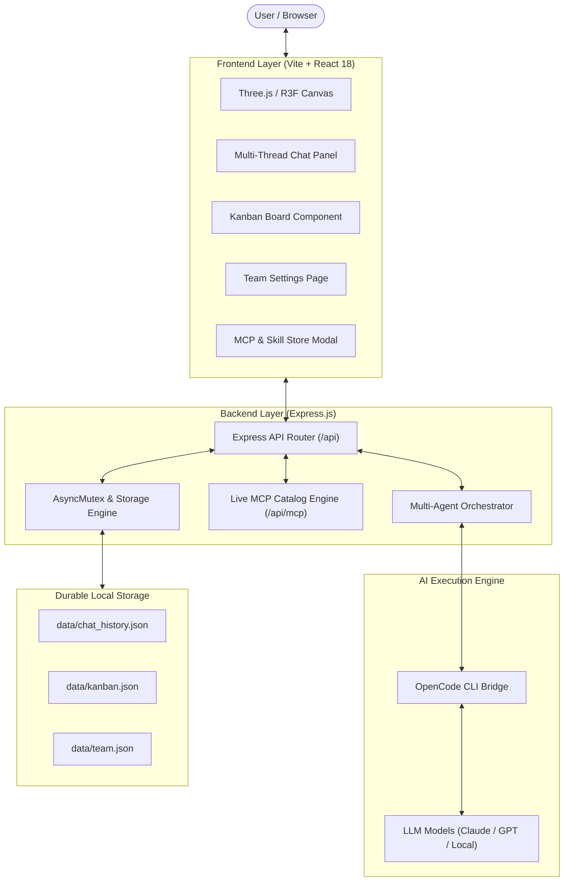

# Pixel Works — Virtual Office

<p align="center">
  <strong>Language / Pilihan Bahasa:</strong>
  <a href="README.md"><strong>English 🇬🇧</strong></a> | 
  <a href="README.id.md"><strong>Bahasa Indonesia 🇮🇩</strong></a>
</p>

<p align="center">
  <strong>Autonomous 3D Virtual Workspace & Multi-Agent AI Collaboration Platform</strong>
  <br />
  An isometric 3D virtual office featuring autonomous AI team orchestration, live Model Context Protocol (MCP) integrations, project-scoped Kanban pipelines, and persistent multi-thread chat.
</p>

<p align="center">
  <a href="https://react.dev"></a>
  <a href="https://threejs.org"></a>
  <a href="https://docs.pmnd.rs/react-three-fiber"></a>
  <a href="https://nodejs.org"></a>
  <a href="https://vitejs.dev"></a>
  <a href="https://expressjs.com"></a>
  
  <a href="LICENSE"></a>
  <a href="CLA.md"></a>
  <a href="CONTRIBUTING.md"></a>
</p>

<p align="center">
  
</p>

---

## Table of Contents

- [Quick Start](#quick-start)
- [Key Features](#key-features)
- [What We Are Looking For (Contribution Wishlist)](#-what-we-are-looking-for-contribution-wishlist)
- [System Architecture](#system-architecture)
- [AI Agent Roster & Specializations](#ai-agent-roster--specializations)
- [Model Context Protocol (MCP) Tools](#model-context-protocol-mcp-tools)
- [Sprint Workflow & Kanban Pipeline](#sprint-workflow--kanban-pipeline)
- [Configuration & Environment Variables](#configuration--environment-variables)
- [REST API Reference](#rest-api-reference)
- [Testing & Verification](#testing--verification)
- [Directory Structure](#directory-structure)
- [Troubleshooting](#troubleshooting)
- [Contributing Guidelines](#contributing-guidelines)
- [License & Dual Licensing](#license--dual-licensing)

---

## Quick Start

Get the application running locally in just a few steps:

### 1. Prerequisites
- **Node.js** v18.0.0 or later ([Download Node.js LTS](https://nodejs.org/))
- **npm** v9+ (bundled with Node.js)
- *(Optional)* **OpenCode CLI** v1.18+ for direct LLM provider execution:
  ```bash
  npm install -g opencode
  opencode providers # Configure AI model provider credentials
  ```

### 2. Installation
Clone the repository and install all dependencies:

```bash
git clone https://github.com/Thecaracter/new_pixel.git
cd new_pixel
npm install
```

Copy the example environment configuration:
```bash
cp .env.example .env
```

### 3. Running the Application
Launch both backend API and Vite frontend dev server concurrently:

```bash
npm run dev
```

Open your browser to:
- **Web Application**: [http://localhost:5173](http://localhost:5173)
- **Backend API**: [http://127.0.0.1:3001](http://127.0.0.1:3001)

> [!TIP]
> **Frontend-Only Mode**: If you only want to work on 3D graphics or UI components without running the backend server, run `npm run dev:frontend`.

---

## Key Features

### 1. Procedural 3D Isometric Office (Three.js & R3F)
- Rendered natively using **React Three Fiber** without relying on heavy external GLTF/OBJ downloads.
- Dynamic character routines: typing at workstations, head turning, corridor walking, and office pet interactions (*Mochi the Cat*).
- Smooth isometric camera parallax responding to mouse pointer and touch gestures.
- Soft isometric shadows, interactive chat speech bubbles, and office atmospheric lighting.

### 2. Autonomous Multi-Agent AI Orchestration
- **7 Domain-Specialized Agent Personas**: Clear boundaries, hardened prompts, and specialized tool access.
- **Leader Mode (Arif)**: Structured 2-phase coordination workflow:
  1. *Clarifying Phase*: Requirements elicitation when user instructions are ambiguous.
  2. *Awaiting Confirmation*: Generating detailed sprint plan proposals with itemized tasks per agent.
- **Multi-Agent Orchestrator (`/api/orchestrate`)**: Cross-agent delegation, consultation, and collaborative task synthesis.
- **On-the-Fly Model Switching**: Dropdown model selection (Claude 3.5 Sonnet, Claude Opus, GPT-4, etc.) with automatic session reset to prevent context bleed.

### 3. Model Context Protocol (MCP) Live Store
- Real-time search across the NPM registry for official and community MCP servers.
- Dynamic agent attachment and execution via standardized tool calling schemas:
  - **Finance (Rina)**: `calculate_budget`, `generate_invoice_draft`, `financial_report_summary`.
  - **Design (Dimas)**: `create_wireframe_spec`, `design_system_tokens`, `ux_review_checklist`.
  - **Engineering & Operations**: Component analyzer, timeline estimation, and code review runners.

### 4. Project-Scoped Kanban Board & Approval Gating
- **Strict Approval Gating**: Leader sprint plans never execute without explicit user approval.
- **Idempotent Task Creation**: Re-approving plans never duplicates existing Kanban tasks.
- **Multi-Project Scoping**: Filter, create, and organize tasks across multiple distinct project boards.
- **Real-Time Kanban Interaction**: Move tasks seamlessly between columns (*Backlog* ➔ *In Progress* ➔ *Done*).

### 5. Persistent Multi-Thread Chat & Durable Storage
- **Thread Isolation**: Create new chat topics, switch active threads, and archive discussions cleanly.
- **Durable JSON Storage**: Complete chat histories and Kanban tasks persisted to disk.
- **Atomic Writes & Concurrency Mutex**: All mutations serialized via `AsyncMutex` preventing file corruption or race conditions.

---

## 🎯 What We Are Looking For (Contribution Wishlist)

We are actively seeking contributions across several core areas. If you'd like to contribute, here are great ideas to get started:

### 1. 🎨 3D Virtual Office & Three.js Visuals (`src/components/three/`)
- **New Office Furniture & Interactive Props**: Add procedural 3D models like an espresso machine (with steam particles!), a break room ping-pong table, blinking LED server racks, whiteboards, and potted plants.
- **Lighting & Atmosphere**: Implement dynamic Day / Night cycle lighting, cozy ambient shadows, custom GLSL shaders, or weather effects (rain on the window).
- **Avatars & Animations**: Add character accessories (glasses, headphones, hoodies), custom skin tones, and new idle animations (sipping coffee, stretching, pacing).
- **Camera & Room Navigation**: Add smooth isometric zoom (wheel scroll), pan controls, or customizable room layouts.

### 2. 🛠️ MCP (Model Context Protocol) Server Integrations (`server/mcp/`)
- **Popular Cloud & Dev Integrations**: Build and test MCP integrations for GitHub, GitLab, PostgreSQL, Redis, Slack, Discord, Notion, Jira, Linear, and Google Workspace.
- **Agent Skill Catalog**: Expand our live registry search (`server/mcp/catalog.js`) to discover and install tools dynamically.

### 3. 🤖 AI Agent Orchestration & LLM Providers (`server/agents/`, `data/team.json`)
- **Local & Alternative LLM Support**: Support local LLM execution via Ollama, LM Studio, or vLLM alongside cloud providers (Anthropic Claude, OpenAI GPT-4, Google Gemini, Groq, DeepSeek).
- **Multi-Agent Collaboration Heuristics**: Improve inter-agent communication, automated peer review (e.g., QA reviewing Developer's code before marking tasks done), and debate pipelines.

### 4. 📊 Project Kanban, Chat UI & Audio Polish (`src/components/`)
- **Kanban Enhancements**: Drag-and-drop task reordering, due date pickers, priority tags, and export/import sprint data (JSON/CSV/Markdown).
- **Sound Effects & Ambience (Optional Audio)**: Add subtle retro 8-bit sound effects (keyboard clacking, task completion chime, agent speech bubble pops) with an easily accessible mute toggle.

### 5. ⚡ WebGL Performance & Optimization
- **Low-End Device Compatibility**: Mesh instancing, geometry batching, texture optimization, and automated FPS throttling when tab is inactive.

For technical guidelines and setup steps, please see [CONTRIBUTING.md](CONTRIBUTING.md).

---

## System Architecture



---

## AI Agent Roster & Specializations

| Name | Role | Specialization | MCP Tools | Avatar Color |
| :--- | :--- | :--- | :--- | :--- |
| **Arif** | Team Leader & Orchestrator | Sprint planning, delegation, requirement validation | Orchestrator Engine | `#4F46E5` (Indigo) |
| **Budi** | Frontend Engineer | React 18, Three.js, CSS, interactive animations | Web Component Spec | `#059669` (Emerald) |
| **Siti** | Backend Engineer | Express API, database schemas, storage integrity | Data Contract Tools | `#D97706` (Amber) |
| **Dimas** | UI/UX Designer | Wireframes, design tokens, accessibility review | `create_wireframe_spec` | `#7C3AED` (Purple) |
| **Rina** | Finance Specialist | Sprint budget calculation, cloud cost estimation | `calculate_budget` | `#DC2626` (Rose) |
| **Bayu** | DevOps Specialist | CI/CD pipelines, containerization, build optimization | Deployment Tools | `#0284C7` (Sky Blue) |
| **Maya** | QA Specialist | Unit tests, test suites, contract verification | Testing Suite Runner | `#EA580C` (Orange) |

---

## Testing & Verification

The project includes an automated test suite (native Node.js Test Runner) validating API contracts, multi-thread isolation, team management, and live MCP catalog searches:

```bash
# Run the test suite (all 29 tests must pass)
npm test

# Verify production Vite build (zero errors)
npm run build
```

---

## Contributing Guidelines

We warmly welcome community contributions from across the globe!
- **Accepting the CLA**: All contributors agree to [CLA.md](CLA.md) by simply checking the agreement checkbox in the Pull Request template upon opening a PR. No third-party accounts or bots required.
- **Workflow & Standards**: Please review [CONTRIBUTING.md](CONTRIBUTING.md) for branch naming conventions, architecture rules (`data/team.json`, MCP tools), and required verification commands.

---

## License & Dual Licensing

Pixel Works Virtual Office is released under a **Dual Licensing model**:

1. **Open Source Community License (GNU AGPLv3)**:
   - Free for non-commercial, personal, and open-source usage.
   - Any public network deployment or modification (SaaS) **must** keep the entire source code open under the same GNU AGPLv3 license.
2. **Commercial Proprietary License**:
   - Required for organizations or individuals who wish to integrate this project into closed-source enterprise software, private SaaS, OEM distribution, or commercial resale without copyleft obligations.
   - To acquire a commercial license, please contact the Project Owner directly.

Full legal texts:
- [LICENSE](LICENSE) (Dual Licensing Notice & GNU AGPLv3)
- [CLA.md](CLA.md) (Contributor License Agreement)

Copyright (c) 2026 Pixel Works Virtual Office. All Rights Reserved.
