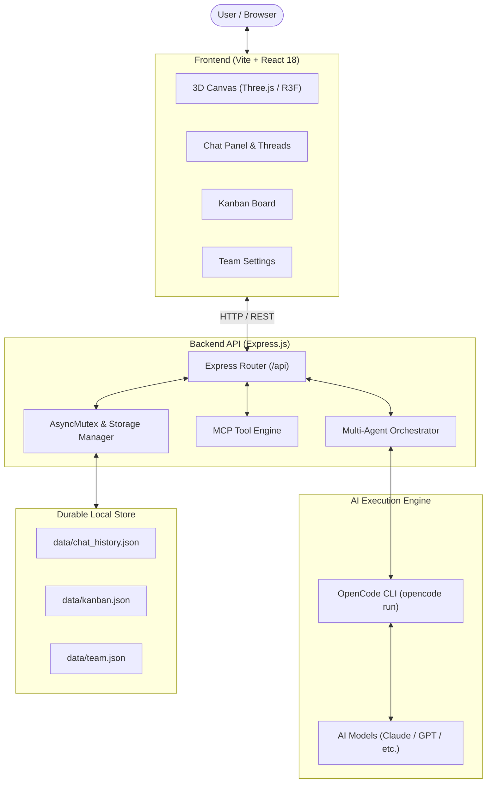

# 🏢 Kantor Virtual — Pixel Works

<p align="center">
  <strong>Open-Source 3D Virtual Office & Autonomous Multi-Agent AI Team</strong>
  <br />
  Ruang kantor virtual 3D isometrik interaktif dengan kolaborasi tim AI mandiri, integrasi Model Context Protocol (MCP), papan Kanban proyek, dan chat multi-thread persisten.
</p>

<p align="center">
  
  
  
  
  
  
  
  
</p>

---

## 📖 Daftar Isi (Table of Contents)

- [⚡ Quick Start (Mulai Cepat)](#-quick-start--mulai-cepat)
- [✨ Fitur Utama (Key Features)](#-fitur-utama--key-features)
- [🏗️ Arsitektur Sistem (Architecture)](#️-arsitektur-sistem--architecture)
- [🤖 Roster Tim AI & Persona Agents](#-roster-tim-ai--persona-agents)
- [🛠️ Model Context Protocol (MCP) Tools](#️-model-context-protocol-mcp-tools)
- [📋 Alur Kerja Sprint & Kanban](#-alur-kerja-sprint--kanban)
- [⚙️ Konfigurasi & Environment Variables](#️-konfigurasi--environment-variables)
- [📡 Dokumentasi API REST](#-dokumentasi-api-rest)
- [🧪 Pengujian (Testing)](#-pengujian--testing)
- [📁 Struktur Direktori Proyek](#-struktur-direktori-proyek)
- [🔧 Penyelesaian Masalah (Troubleshooting)](#-penyelesaian-masalah--troubleshooting)
- [🤝 Panduan Kontribusi (Contributing)](#-panduan-kontribusi--contributing)
- [📄 Lisensi (License)](#-lisensi--license)

---

## ⚡ Quick Start (Mulai Cepat)

Hanya butuh 3 langkah untuk menjalankan seluruh aplikasi di komputer Anda:

### 1. Prasyarat
- **Node.js** versi 18 atau lebih tinggi ([Unduh Node.js](https://nodejs.org/))
- **npm** (otomatis terpasang bersama Node.js)
- *(Opsional)* **OpenCode CLI** jika ingin menghubungkan chat ke model LLM riil:
  ```bash
  npm install -g opencode
  opencode providers # konfigurasi API key penyedia AI Anda
  ```

### 2. Instalasi & Setup

```bash
# 1. Clone repository ini
git clone https://github.com/<username>/new_pixel.git
cd new_pixel

# 2. Pasang dependensi
npm install

# 3. (Opsional) Salin template environment jika ingin custom port/model
cp .env.example .env
```

### 3. Menjalankan Aplikasi

Jalankan server pengembangan (Express Backend + Vite Frontend):

```bash
npm run dev
```

Server akan aktif pada:
- 🌐 **Frontend (UI Web)**: [http://localhost:5173](http://localhost:5173)
- 🔌 **Backend API Proxy**: [http://127.0.0.1:3001](http://127.0.0.1:3001)

> 💡 **Mode Frontend-Only**: Jika Anda hanya ingin mendesain antarmuka 3D tanpa backend AI, jalankan `npm run dev:frontend`.

---

## ✨ Fitur Utama (Key Features)

### 🏢 1. Ruang Kantor Isometrik 3D Interaktif (Three.js & R3F)
- **Voxel-style 3D Office**: Dirender sepenuhnya secara prosedural menggunakan `@react-three/fiber` dan Three.js (tanpa aset 3D eksternal yang berat).
- **Karakter Beranimasi Halus**: Gerakan mengetik di meja, berjalan di lorong, berpikir, berbicara, serta kucing kantor interaktif (*Mochi the Cat*).
- **Efek Kamera & Parallax**: Sudut pandang isometrik responsif yang bereaksi halus terhadap posisi kursor mouse dan sentuhan layar.
- **Interaktivitas & Tooltips**: Arahkan kursor atau ketuk meja, karakter, dan perlengkapan kantor untuk melihat profil anggota tim.
- **Speech Bubbles & Partikel**: Balon percakapan berotasi otomatis dan partikel atmosfer kantor yang dinamis.

### 🤖 2. Tim AI Otonom & Multi-Agent Orchestrator
- **7 Spesialis AI**: Terdiri dari Lead, Akuntan, UI/UX Designer, Frontend Engineer, Marketer, Sales, dan Ops Admin.
- **Leader Mode (Arif)**: Alur kerja 2 fase yang cerdas:
  1. *Clarifying Phase*: Menggali kebutuhan teknis jika instruksi user masih ambigu.
  2. *Awaiting Confirmation*: Menyusun rencana kerja sprint lengkap dengan breakdown tugas per anggota tim.
- **Multi-Agent Orchestrator (`/api/orchestrate`)**: Mengoordinasikan pembagian tugas antar-agent, memfasilitasi konsultasi silang (cross-agent consultation), dan merangkum hasil kerja kolektif.
- **Multi-Model Support**: Pilih model AI langsung dari dropdown antarmuka (Claude 3.5 Sonnet, Claude Opus, Haiku, GPT, dsb.) dengan pemisahan konteks sesi otomatis.

### 🛠️ 3. Integrasi Model Context Protocol (MCP)
- Backend menyediakan alat bantu domain riil bagi agent (`/api/mcp/tools`):
  - **Finance (Rina)**: `calculate_budget`, `generate_invoice_draft`, `financial_report_summary`.
  - **Design (Dimas)**: `create_wireframe_spec`, `design_system_tokens`, `ux_review_checklist`.
  - **Engineering & Operations**: Tools eksekusi dan estimasi timeline.

### 📋 4. Papan Kanban Interaktif & Manajemen Proyek
- **Gating Persetujuan 1-Klik**: Rencana kerja yang dirumuskan oleh Leader tidak akan langsung dieksekusi tanpa persetujuan user. Cukup balas "setuju" di chat atau klik tombol *Approve Plan*.
- **Backlog Otomatis**: Tugas yang disetujui otomatis masuk ke kolom **Backlog** papan Kanban dengan penugasan ke agent yang relevan.
- **Multi-Project Kanban**: Kelola berbagai inisiatif proyek dengan isolasi daftar tugas per project ID.
- **Manajemen Kolom**: Perbarui status tugas secara instan (Backlog ➔ In Progress ➔ Done) atau hapus tugas dengan aman.

### 💬 5. Chat Multi-Thread & Persistensi Durabel Anti-Race-Condition
- **Thread Percakapan Terisolasi**: Buat topik diskusi baru, beralih antar-thread, ubah judul thread, atau hapus thread lama.
- **Penyimpanan Durabel JSON**: Riwayat chat dan tugas Kanban disimpan secara aman di disk lokal (`data/chat_history.json`, `data/kanban.json`).
- **Atomic Writes & Concurrency Mutex**: Seluruh operasi penulisan data dilindungi oleh in-process `AsyncMutex` dan penulisan file atomik untuk mencegah *data race* atau file JSON korup.
- **Perlindungan Batasan Data (DoS Limits)**: Mencegah serangan payload raksasa dengan batasan karakter pada judul, deskripsi tugas, dan jumlah task.

### 👥 6. Kustomisasi Tim & Karakter (Team Settings)
- Halaman **Team Settings** khusus untuk menyesuaikan seluruh anggota kantor:
  - Aktifkan atau nonaktifkan agent tertentu dari ruang 3D.
  - Kustomisasi warna pakaian (warna kemeja, celana, rambut, dan warna kulit).
  - Tentukan model LLM spesifik untuk masing-masing agent (misal: Rina memakai Haiku untuk kecepatan, Dimas memakai Opus untuk penalaran kreatif).

---

## 🏗️ Arsitektur Sistem (Architecture)



---

## 🤖 Roster Tim AI & Persona Agents

Ruang kantor virtual dihuni oleh anggota tim dengan domain keahlian masing-masing:

| Avatar | Nama | Peran (Role) | Domain MCP | Tugas Utama |
| :---: | :--- | :--- | :--- | :--- |
| 🧑‍💼 | **Arif** | *Project Lead / Coordinator* | Operations | Elicitation requirement, breakdown tugas sprint, delegasi antar-agent |
| 💰 | **Rina** | *Finance / Accountant* | Finance | Estimasi budget proyek, kalkulasi invoice, laporan keuangan |
| 🎨 | **Dimas** | *UI/UX Designer* | Design | Spesifikasi wireframe, desain antarmuka, evaluasi pengalaman pengguna |
| 💻 | **Bayu** | *Frontend Engineer* | Engineering | Perancangan komponen UI, integrasi kode, alur logika aplikasi |
| 📢 | **Sinta** | *Marketing / Growth* | Marketing | Copywriting promosi, kampanye produk, strategi go-to-market |
| 🤝 | **Mira** | *Sales / Client Relations* | Sales | Komunikasi klien, penyusunan pitching proposal, relationship management |
| ⚙️ | **Eko** | *Operations / Admin Support* | Operations | Timeline sprint, dokumentasi administrasi, SOP dan alur kerja |

---

## 🛠️ Model Context Protocol (MCP) Tools

Agen AI dapat mengeksekusi fungsi terstruktur untuk menghasilkan data riil tanpa halusinasi:

- `calculate_budget`: Menghitung breakdown biaya per item beserta total anggaran (dalam IDR/mata uang pilihan).
- `generate_invoice_draft`: Menghasilkan draf tagihan resmi (`INV-XXXXXX`) dengan daftar pekerjaan dan tanggal jatuh tempo.
- `financial_report_summary`: Menganalisis pemasukan vs pengeluaran untuk menentukan laba/rugi dan persentase margin keuntungan.
- `create_wireframe_spec`: Menyusun rancangan komponen antarmuka, layout, dan user flow halaman web.
- `design_system_tokens`: Menghasilkan palet warna, tipografi, dan skala spasi untuk pedoman desain.

Daftar lengkap tools dapat diakses lewat endpoint `GET /api/mcp/tools`.

---

## 📋 Alur Kerja Sprint & Kanban

```text
[User Prompt]
      │
      ▼
[Leader Mode: Arif] ─── (Kebutuhan belum jelas?) ──► [Fase Clarifying: Ajukan Pertanyaan]
      │
      ▼ (Kebutuhan jelas)
[Fase Awaiting Confirmation: Susun Rencana Sprint + Tasks]
      │
      ├──────────────────────────────┐
      ▼                              ▼
[User membalas "setuju"]      [User klik "Approve Plan"]
      │                              │
      └──────────────┬───────────────┘
                     ▼
  [Idempotency Check + Mutex Lock]
                     ▼
  [Tasks Dibuat di Kolom Backlog Kanban]
                     ▼
  [User / Tim Menggeser Task: In Progress ➔ Done]
```

---

## ⚙️ Konfigurasi & Environment Variables

Aplikasi siap dijalankan langsung dengan pengaturan bawaan. Jika ingin mengubah konfigurasi, buat file `.env` di direktori utama:

| Variabel | Tipe | Default | Keterangan |
| :--- | :---: | :---: | :--- |
| `BACKEND_PORT` | `Number` | `3001` | Port untuk server Express backend |
| `OPENCODE_MODELS` | `String` | *(Daftar bawaan)* | Daftar ID model AI yang dipisahkan tanda koma |
| `CHAT_STORAGE_FILE` | `String` | `data/chat_history.json` | Path file penyimpanan durabel riwayat chat |
| `KANBAN_STORAGE_FILE` | `String` | `data/kanban.json` | Path file penyimpanan durabel papan Kanban |
| `NODE_ENV` | `String` | `development` | Mode aplikasi (`development` atau `production`) |

Contoh `.env`:
```env
BACKEND_PORT=3001
OPENCODE_MODELS=9router/claude-haiku-4.5-thinking-agentic,9router/claude-opus-4-1-latest,9router/claude-sonnet-4-20250514
NODE_ENV=development
```

---

## 📡 Dokumentasi API REST

Server backend mengekspos endpoint API berikut:

### Chat & Koordinasi AI

#### 1. `POST /api/chat`
Mengirim pesan ke AI dalam mode Chat Standar atau Mode Leader (Arif).
- **Body:**
  ```json
  {
    "message": "Kita mau buat fitur autentikasi Google Login",
    "mode": "leader",
    "sessionId": "ses_opsional",
    "model": "9router/claude-opus-4-1-latest"
  }
  ```
- **Respons (Leader Mode - Clarifying):**
  ```json
  {
    "reply": "Sebelum menyusun rencana, ada beberapa hal teknis yang perlu dipastikan.",
    "mode": "leader",
    "phase": "clarifying",
    "questions": [
      "Apakah menggunakan Firebase Auth atau server OAuth sendiri?",
      "Apakah butuh role permission khusus setelah login?"
    ]
  }
  ```

#### 2. `POST /api/orchestrate`
Memicu koordinasi multi-agent untuk tugas kompleks yang melibatkan lebih dari satu divisi.

#### 3. `GET /api/chat/threads` & `POST /api/chat/threads`
Mendapatkan daftar thread percakapan aktif atau membuat thread baru.

#### 4. `POST /api/chat/approve-plan`
Menyetujui sprint plan dan memasukkan tugas ke papan Kanban secara idempoten.

---

### Kanban & Proyek

- `GET /api/kanban/tasks`: Mengambil semua daftar tugas Kanban beserta kolomnya.
- `POST /api/kanban/tasks`: Membuat tugas baru secara manual.
- `PATCH /api/kanban/tasks/:id`: Memperbarui status kolom (`backlog`, `in_progress`, `done`) atau data tugas.
- `DELETE /api/kanban/tasks/:id`: Menghapus tugas dari Kanban.
- `GET /api/kanban/projects` & `POST /api/kanban/projects`: Mengelola kategori proyek Kanban.

---

### Manajemen Tim & Sistem

- `GET /api/team`: Mengambil seluruh daftar anggota tim beserta status aktif dan warna pakaian.
- `POST /api/team`: Menambahkan anggota tim baru.
- `PUT /api/team/:id`: Memperbarui profil, warna pakaian, atau model AI anggota tim.
- `GET /api/models`: Mengambil daftar model AI yang tersedia di sistem.
- `GET /api/mcp/tools`: Mengambil spesifikasi tool MCP yang terdaftar.
- `GET /api/health`: Mengecek status kesehatan server backend.

---

## 🧪 Pengujian (Testing)

Proyek ini dilengkapi dengan unit test dan contract test berbasis runner bawaan Node.js (`node:test`):

```bash
# Menjalankan seluruh pengujian (contract & unit tests)
npm test

# Menjalankan unit tests cepat (Leader, Team Management, Thread & Project Kanban)
npm run test:unit

# Menjalankan integration tests (Chat Contract & Durable Kanban)
npm run test:integration
```

---

## 📁 Struktur Direktori Proyek

```text
new_pixel/
├── data/                         # Penyimpanan data JSON durabel
│   ├── chat_history.json         # Riwayat percakapan & sesi aktif
│   ├── kanban.json               # Tugas, proyek, & plan Kanban
│   └── team.json                 # Roster kustom anggota tim
├── public/                       # Aset publik statis
├── server/                       # Express.js Backend Service
│   ├── agents/                   # Logika AI Agents
│   │   ├── definitions.js        # Persona prompt, domain, & tools agent
│   │   └── orchestrator.js       # Logika Multi-Agent Orchestration
│   ├── mcp/                      # Model Context Protocol Engine
│   │   ├── server.js             # MCP registry & runtime execution
│   │   └── tools.js              # Implementasi fungsi tool domain
│   ├── index.js                  # Entrypoint server & rute REST API
│   └── storage.js                # AsyncMutex & atomic JSON read/write
├── src/                          # Frontend React 18 Application
│   ├── components/               # Komponen Antarmuka Pengguna
│   │   ├── three/                # Komponen 3D Three.js & R3F
│   │   │   ├── CatMochi.jsx      # Kucing kantor interaktif
│   │   │   ├── Character.jsx     # Mesh & animasi karakter 3D
│   │   │   ├── Characters.jsx    # Manajemen seluruh karakter di ruang
│   │   │   ├── Furniture.jsx     # Meja, kursi, komputer, tanaman
│   │   │   ├── OfficeCanvas.jsx  # Stage Three.js Canvas & kontrol kamera
│   │   │   └── OfficeRoom.jsx    # Dinding, lantai isometrik, & lighting
│   │   ├── ChatPanel.jsx         # Antarmuka panel chat & thread manager
│   │   ├── KanbanBoard.jsx       # Papan Kanban drag-and-drop / status
│   │   ├── OfficeHeader.jsx      # Header navigasi & indikator status tim
│   │   ├── TeamSettingsPage.jsx  # Halaman kustomisasi karakter & roster
│   │   └── VirtualOfficePage.jsx # Shell utama & manajemen tab halaman
│   ├── App.jsx                   # Root component dengan Error Boundary
│   ├── index.css                 # Sistem desain global & styling
│   └── main.jsx                  # React DOM mount point
├── tests/                        # Suite pengujian otomatis (Node.js Test)
│   ├── api-chat-contract.mjs
│   ├── durable-chat-kanban.mjs
│   ├── leader-contract.mjs
│   ├── team-management.mjs
│   └── thread-and-project-kanban.mjs
├── .env.example                  # Template konfigurasi environment
├── CONTRIBUTING.md               # Panduan berkontribusi untuk developer
├── LICENSE                       # Lisensi open-source MIT
├── package.json                  # Dependensi & skrip proyek
└── vite.config.js                # Konfigurasi bundler Vite & API proxy
```

---

## 🔧 Penyelesaian Masalah (Troubleshooting)

### 1. Chat menampilkan "Backend not running — start with: npm run dev"
Frontend tidak dapat menghubungi Express backend di port 3001.
- Pastikan Anda menjalankan perintah `npm run dev` (bukan `npm run dev:frontend`).
- Periksa konsol terminal apakah port 3001 sudah digunakan aplikasi lain. Jika port terpakai, jalankan:
  ```bash
  BACKEND_PORT=3002 npm run dev
  ```

### 2. Chat menampilkan "OpenCode service unavailable"
- Pastikan OpenCode CLI terpasang di sistem: `opencode --version`.
- Jika belum terpasang: `npm install -g opencode`.
- Pastikan akun provider AI sudah disetup dengan menjalankan `opencode providers`.

### 3. Tampilan 3D tidak muncul / Layar hitam
- Periksa apakah browser Anda mendukung WebGL dengan membuka `chrome://gpu` atau [get.webgl.org](https://get.webgl.org/).
- Nonaktifkan ekstensi pemblokir hardware acceleration jika ada.

---

## 🤝 Panduan Kontribusi (Contributing)

Kami menyambut segala bentuk kontribusi dari komunitas!
- 🐛 **Laporkan Bug**: Buat [Issue](https://github.com/<username>/new_pixel/issues) baru dengan menyertakan langkah reproduksi.
- 💡 **Usulkan Fitur**: Diskusikan ide fitur baru melalui tab Issues atau Discussions.
- 🚀 **Kirim Pull Request**: Baca [CONTRIBUTING.md](CONTRIBUTING.md) untuk panduan lengkap mengenai branching, pengujian, dan standar commit.

---

## 📄 Lisensi (License)

Proyek ini didistribusikan di bawah lisensi terbuka **MIT License**. Lihat berkas [LICENSE](LICENSE) untuk informasi hak cipta selengkapnya.

---

<p align="center">
  Dibuat dengan ❤️ untuk kemajuan ekosistem AI Agent dan Open-Source Web 3D.
  <br />
  <strong>Bintang ⭐ repositori ini jika Anda menyukainya!</strong>
</p>
